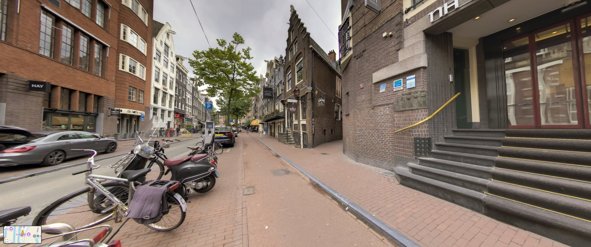
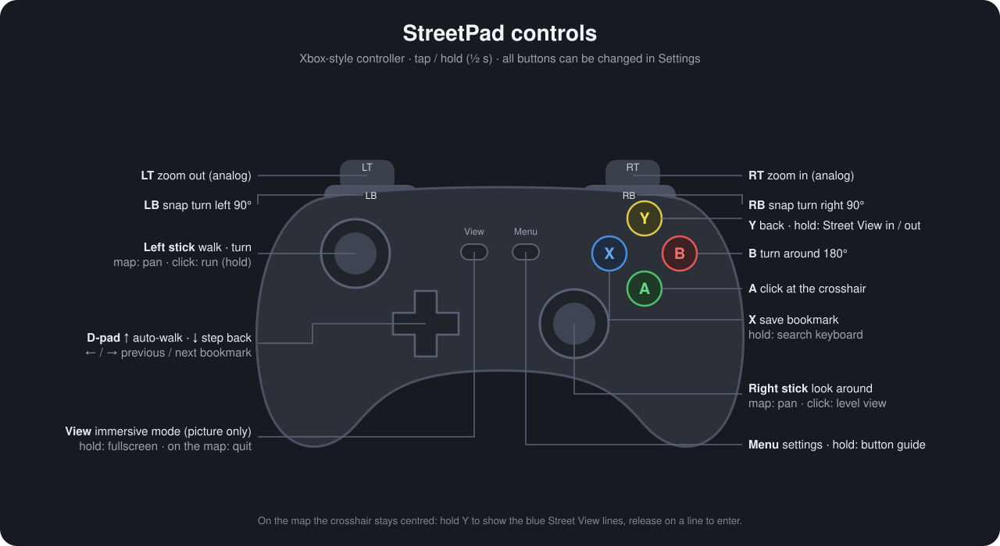
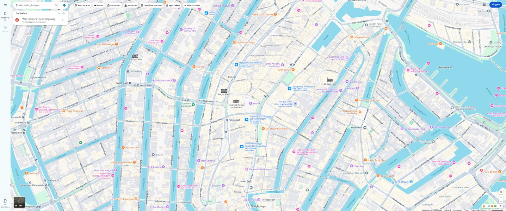
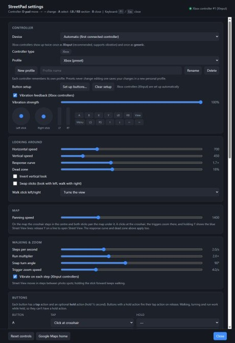

# StreetPad

**Walk Google Street View with an Xbox controller, like a first-person game.**

StreetPad opens Google Maps in its own fullscreen window and lets you explore the world with a
game controller: look around with the right stick, walk with the left, zoom with the triggers,
and jump into Street View anywhere on the map. One small `.exe`, nothing to install.



## Download

**[Download StreetPad.exe (latest release)](https://github.com/ZoutMax/StreetPad/releases/latest)**

Double-click it. That's all: no installer, no setup, it runs from any folder or a USB stick.

> Windows may show "Windows protected your PC" the first time (the exe isn't code-signed yet).
> Click **More info → Run anyway**.

## Controls



Every button has a **tap** and an optional **hold** action, and everything can be changed in
**Settings** (Menu button or F1). Hold **Menu** to see the current layout on screen.

## Features

- **Street View like a game:** smooth looking around (synced to your screen's refresh rate),
  walking and running, precise turns (180° and snap turns), level view, analog zoom.
- **Map mode:** the crosshair stays in the centre, both sticks pan the map; hold **Y** to show
  the blue Street View lines and release on a line to step in. Hold **Y** in Street View to go
  back to the map, right where you were.
- **Immersive mode (View):** picture only, no Google buttons, no street names or ground markers
  drawn into the view, just the mini-map.
- **Click with the crosshair (A):** open shops and places; the view holds still while the panel
  is open and the next controller input returns to exactly your view.
- **Bookmarks** (save with X, browse with the D-pad) and an **on-screen search keyboard**
  (hold X) with recent searches.
- **Controller profiles like in games:** presets for Xbox, PlayStation, Nintendo Switch and
  generic gamepads, personal profiles, button names that match your controller, and a button
  setup wizard for unknown pads.
- **Vibration feedback** with a different feel for walking, running, turning, bookmarks and more.
- **Sign in with your Google account**, or use private mode (nothing kept after closing).
- Works while another window is in front, brings itself forward when you use the controller,
  remembers your monitor and last position, and only one copy runs at a time.



## Requirements

- Windows 10 or 11, 64-bit
- Microsoft Edge WebView2 Runtime (already part of Windows 10/11)
- A game controller: Xbox controllers work best (vibration, background use); PlayStation,
  Switch and generic USB/Bluetooth gamepads are supported too

## Privacy

- Settings and bookmarks are stored in the Windows registry (`HKCU\Software\StreetPad`).
- Your Google login stays in a local browser profile (`%LOCALAPPDATA%\StreetPad`), or nowhere at
  all in private mode.
- StreetPad itself sends nothing anywhere; it shows the Google Maps website like a browser does.

<p align="center"></p>

## Build from source

The app is written in Rust (wry / WebView2, XInput, gilrs) and is built from Linux or WSL with
the Windows MSVC target:

```sh
cargo install cargo-xwin            # once; needs clang, lld, llvm (llvm-rc)
rustup target add x86_64-pc-windows-msvc
cargo xwin build --release          # -> target/x86_64-pc-windows-msvc/release/StreetPad.exe
```

The static CRT and the statically linked WebView2 loader make the exe depend only on Windows
itself.

### Tests

```sh
tools/check.sh          # unit tests (run on Windows via WSL interop) + release build
tools/check.sh --live   # ...plus a self-test inside the real Google Maps page
tools/e2e.py            # end-to-end: scripted controller actions in the real app
```

`tools/e2e.py` backs up the user's settings first and restores them afterwards. It checks
turning, level view, walking, bookmarks, immersive mode, entering and leaving Street View, the
search keyboard, quitting, the settings page, private mode and single-instance behaviour.

Diagnostics options: `--settings`, `--url <address>`, `--debug-js <file>`,
`--debug-actions <file>`, `--debug-sample <js|@file>`, `--debug-js-ui <file>`,
`--debug-cdp <file>` (see `src/main.rs`).

## License

Copyright © 2026 zoutmax. All rights reserved. See [LICENSE](LICENSE).

StreetPad is an independent project, not affiliated with Google or Microsoft. Google Maps and
Street View are trademarks of Google LLC; Xbox is a trademark of Microsoft Corporation.
